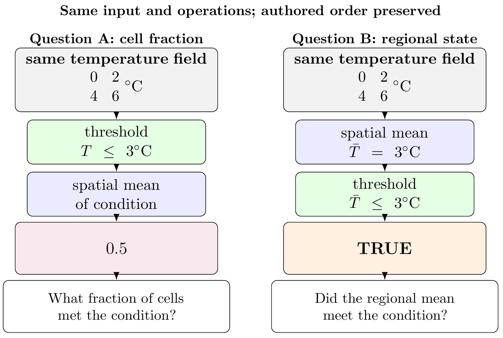

## Summary

Environmental analysis scripts often combine source selection, temporal and spatial support, thresholds, missing-value decisions, and operation order without making those choices easy to inspect. CubeDynamics is an open-source Python package that adds a small, inspectable composition layer around ordinary xarray objects [@hoyer2017xarray]. Environmental inputs are named with source-qualified nouns; configured verbs expose parameters and run in the order written; semantic state describes what the current object represents; and a local trace records completed operations. The package is not a new array format, storage system, or workflow scheduler. It is intended for researchers who already use the scientific Python ecosystem and want the meaning and limits of an analysis to remain visible alongside its computation.

For example, applying a threshold to each cell and then averaging asks for the fraction of cells that meet a condition. Averaging first and then applying the same threshold asks whether the regional mean meets it. Both are valid computations, but they answer different questions. CubeDynamics preserves authored order and records the state transition rather than treating these sequences as interchangeable. The full technical reference, source catalog, worked protocol, and revision-specific evidence are organized in the [project documentation](https://cu-esiil.github.io/cubedynamics/).



## Statement of need

Re-executing code can show that a computation runs again; it does not by itself reveal which product was requested, what interval a timestamp represents, how inputs were aligned, or whether a reduction happened before or after a condition was formed. In environmental work these are scientific choices, not merely implementation details. A short script may distribute them among data loaders, notebook cells, array operations, helper functions, and metadata edits.

CubeDynamics makes a subset of those choices inspectable within Python. A source qualifier distinguishes products that share an everyday variable name. A pipe makes operation order visible. Semantic state and diagnostics expose selected changes in object interpretation, while ordinary xarray values remain available for existing libraries. This is a complement to, not a replacement for, xarray, Dask, climate-indicator packages, or domain-specific methods. Inspectability does not validate source metadata or scientific suitability. In particular, the current two-valued condition model treats missing numerical comparisons as false; users must account for that limitation when interpreting condition reductions.

## State of the field

xarray provides labeled multidimensional arrays and datasets, while Dask supports parallel and lazy computation [@hoyer2017xarray; @rocklin2015dask]. Earth-observation data-cube systems organize multidimensional data for analysis [@giuliani2017cube]. Environmental Python projects also provide focused capabilities: xclim implements climate indicators, clisops provides climate-data operations, intake-esm catalogs and loads Earth-system-model collections, and ESMValTool organizes model evaluation [@bourgault2023xclim; @clisops2026; @intakeesm2026; @righi2020esmvaltool]. Broader workflow systems and standards address execution, portability, and orchestration [@deelman2015pegasus; @crusoe2022cwl].

CubeDynamics occupies a narrower layer within this ecosystem. It does not seek to replace numerical libraries or duplicate specialist algorithms. It connects an environmental noun and its provider/product identity to ordered transformations, declared state changes, local inspection records, and contract-focused tests. The intent is that existing scientific arrays and domain methods can remain in use while the analytical statement becomes easier to review. The package makes no claim that its vocabulary is a complete environmental ontology or that shared labels make products scientifically equivalent.

## Software design

The public expression uses ordinary Python composition:

```python
pipe(noun) | verb(parameters) | verb(parameters)
```

A noun returns a familiar xarray object with source and product information retained in metadata and provenance records. A configured verb accepts the current value, performs one transformation, and updates the package's semantic state. The pipe records the operation name, parameters, messages, and state transition. Inspection methods expose the current explanation, state, trace, and validation report; `unwrap` returns the underlying object to ordinary Python. The local trace begins at `pipe()` and ends at `unwrap()`: it does not capture earlier data preparation, later computations, or a complete workflow environment.

The current state vocabulary distinguishes observations, continuous and categorical fields, conditions, events, features, relationships, summaries, and networks. Contracts constrain selected transitions. For example, thresholding a numeric field produces a condition dataset with a Boolean `state` variable; reducing that condition over time yields an unweighted occurrence proportion. Variance updates known units by squaring them. Event operations require appropriate temporal variation, and the user declares spatial connectivity when local events are consolidated into regional episodes.

Composition is deliberately explicit. Logical overlap requires exact coordinate agreement and reports known temporal-support incompatibilities; it does not silently reproject, resample, intersect, shift, or truncate inputs. Coordinate equality is a computational condition, not proof of shared observational support or scientific comparability. The architecture is primarily linear: separately unwrapped branches keep separate traces, and the final combination does not automatically merge complete upstream histories. User-provided callables remain extensible but their scientific intent and output contract are not validated like maintained verbs.

The worked protocol asks where, within a bounded central South Dakota window during July 2024, PRISM daily maximum temperature is at or above each grid cell's empirical 0.75 quantile and daily precipitation is at or below 0.1 mm. Both inputs use the same daily product family and the reviewed fixture reports identical coordinates, so this example avoids rather than solves cross-product harmonization. The reported co-occurrence is 6.5–22.6% (2–7 of 31 indexed days) for the recorded fixture. “Warm” is a within-month, cell-wise rank, not a climatological anomaly; the result is an illustrative weather screen, not an impact, drought, causal, or risk classification. The fixture, generated map, and serialized inspection outputs are not assembled in the current submission workspace, so this paper treats the result as a bounded protocol and repository record rather than a reproduced empirical figure.

Verification is organized around documented contracts: direct-versus-piped comparisons, state transitions, operation-order cases, alignment diagnostics, unit updates, and expected rejection of inadmissible transitions. The public `0.1.0rc3` artifact and later repository checks are separate evidence layers. The available record does not provide a single frozen archive that joins every later claim to an exact source revision, environment, raw test report, and skip list. Quantitative aggregate validation totals are therefore not claimed here.

The [source repository](https://github.com/CU-ESIIL/cubedynamics) is distributed under the MIT License. PyPI records the `0.1.0rc3` source distribution, uploaded September 2, 2026, and its verified publishing attestation to source commit `f777eb07d3ada8bd407b027f560727c90f6d3731` [@cubedynamics2026rc3]. Install that artifact with `python -m pip install cubedynamics==0.1.0rc3`. The repository README identifies the checkout as rc3 but still says PyPI contains rc1 and recommends installing rc1; the hosted documentation also foregrounds rc1. Synchronize those instructions with the attested rc3 release before submission [@cubedynamics2026repo; @cubedynamics2026site].

## Research impact statement

The intended impact is to make consequential environmental-analysis choices inspectable without requiring researchers to leave ordinary Python or replace their existing array and domain-method tools. The software has been used by its developer in the bounded Working Lands protocol, and the current evidence also includes documented source-specific metadata and QA, executable teaching examples, contract-oriented tests, and a public installable release candidate [@cubedynamics2026workinglands; @cubedynamics2026validation; @cubedynamics2026rc3; @cubedynamics2026repo]. It does not demonstrate increased productivity, improved scientific decisions, external adoption, or superiority to another workflow. Before review, the submission should include an exact, citable software revision and runnable validation materials; the fixture and output records noted above remain archival gaps. The present impact case is consequently a developer-used, near-term software-engineering contribution, not evidence of broad community adoption.

## AI usage disclosure

OpenAI Codex (the authoring environment identifies the model family as GPT-5; the exact serving-model identifier is not exposed here) was used for manuscript restructuring and editing, migration of supplementary material into documentation pages, and checking current JOSS guidance. Earlier Codex assistance described in the source manuscript included LaTeX diagnostics, repository and documentation checks, literature review, and conceptual figure design. For this draft, claims were compared against the supplied manuscript and Supplementary Information, citations were checked against the supplied bibliography, and the journal format was checked against JOSS's official guidance. Final human review and verification have not yet occurred. Before submission, the author must review, correct, and validate every AI-assisted change and confirm this disclosure.

## Acknowledgements

The author acknowledges the maintainers of the scientific Python libraries on which CubeDynamics depends and the organizations that provide the environmental data products used in its validation examples. The source manuscript does not specify whether this work received financial support; the author should add or confirm an applicable funding statement before submission.

## Competing interests

The author declares no competing interests.